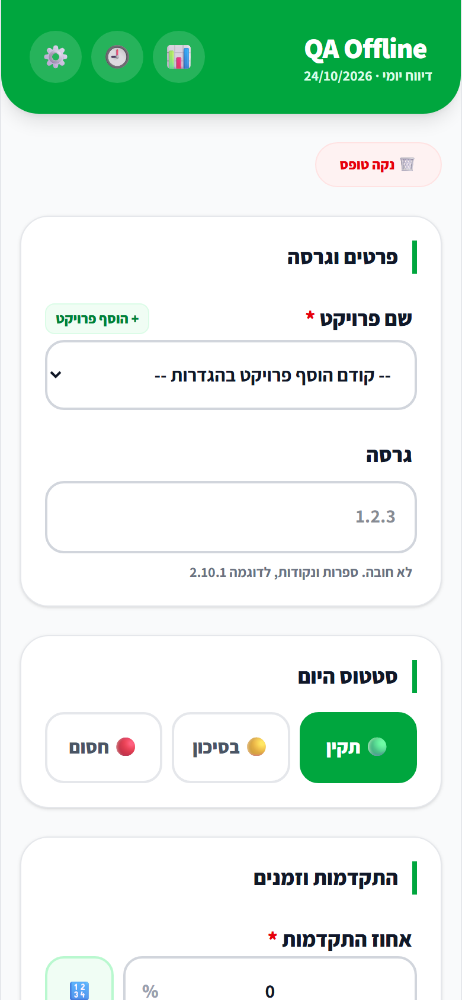
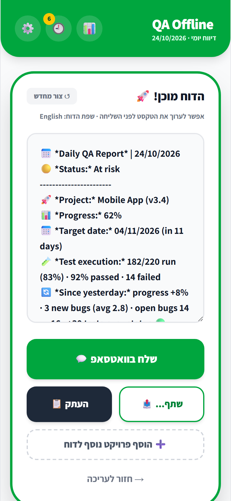
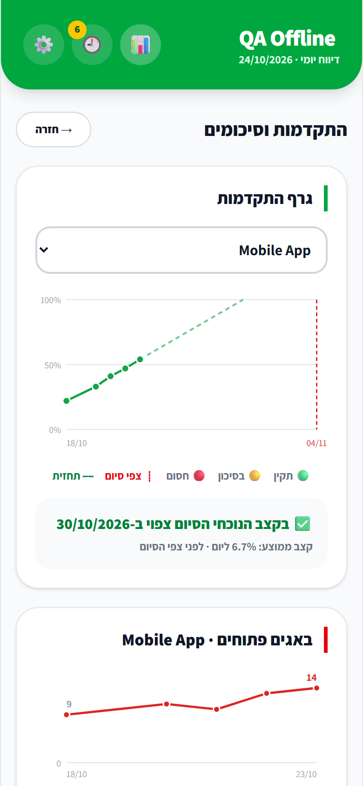
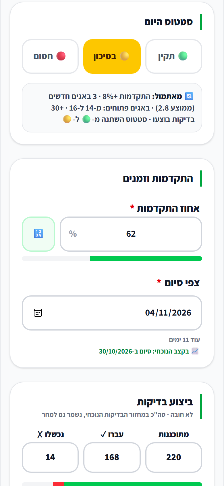
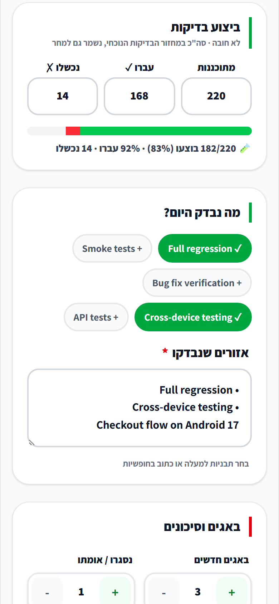
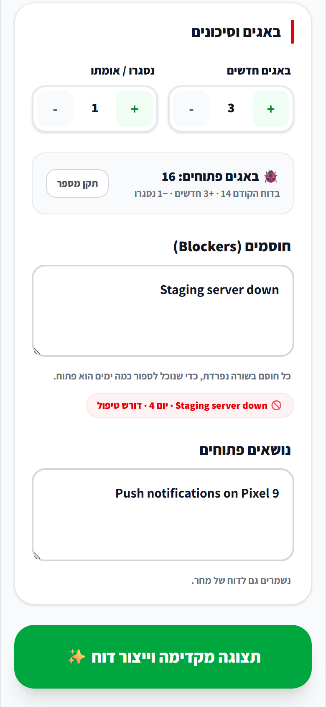
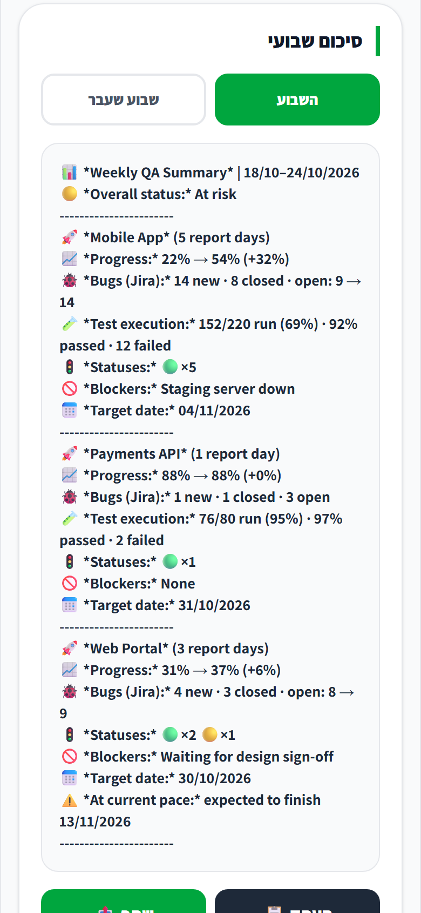
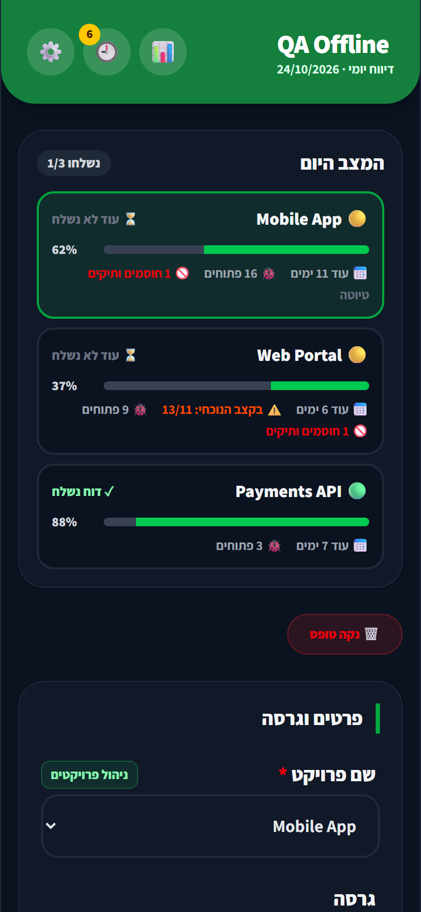

**English** | [עברית](README.he.md)

<p align="center">
  
</p>

# QA Daily Offline

**A fully offline daily QA reporting app for Android.** Fill in a short form, and the app writes a clean, WhatsApp-ready status report, tracks every project day by day, and shows the team where things stand: progress, forecast, open bugs, test execution and blockers.

No account, no server, no internet permission: everything stays on the device.

<p align="center">
  
  
  
</p>

> The app interface is in Hebrew (RTL). Reports can be generated in **Hebrew or English**.

## Who it's for

| | |
|---|---|
| **Testers** | A daily report in under a minute: quick templates, numbers that carry over from yesterday, one-tap WhatsApp / share / copy. |
| **Developers** | Clear facts in every report: version, test execution, new vs. closed bugs, blockers and how long each has been open. |
| **Project managers** | One glance at every project, what changed since yesterday, a forecast against the target date, and a weekly summary ready to forward. |

## Features

### Know where things stand, every day
- **Today dashboard**: one card per project with status, progress, days to the target date, pace forecast, open bugs, long-running blockers, and whether today's report was already sent.
- **Since yesterday**: an automatic line in the form and the report, e.g. *progress +8% · 3 new bugs (avg 2.8) · open bugs 14 → 16 · +30 tests run · status 🟢 → 🟡 · resolved: Staging server down*.
- **Blocker age**: one blocker per line; each shows how many days it has been open (*"Staging server down (day 4)"*) and turns red from day 3.

### The daily report
- **Daily status**: 🟢 On track / 🟡 At risk / 🔴 Blocked at the top of the report, with a hint when blockers are filled in but the status is still green.
- **Test execution**: planned / passed / failed for the current cycle → *"182/220 run (83%) · 92% passed · 14 failed"*.
- **Bug balance**: new and closed/verified bugs; the open-bug count is carried over from the previous report automatically (with a manual override).
- **Quick templates**: one-tap lines such as *Full regression* or *Smoke tests*, editable in settings.
- **Multi-project report**: several projects in one message, with the overall status set by the worst one.
- **Per-project memory**: picking a project restores its version, progress, target date, test counts, open issues and blockers.
- **Edit before sending**: the generated text is editable; send via WhatsApp, the Android share sheet, or copy.

### Insights for managers
- **Progress chart** per project, colored by daily status, with the target date and a dashed trend line.
- **Pace forecast**: a linear trend over the last two weeks. If completion is expected after the target date, a warning appears in the form, on the dashboard and in the report itself.
- **Open bugs chart**: falling means the product is stabilising.
- **Weekly summary** for this week or last week: report days, progress from → to, bugs, test execution, statuses, blockers and late forecasts.

### Everyday comfort
- **Report history**: every report that was sent or copied is saved and can be re-shared.
- **Daily reminder**: a local notification at a chosen time and weekdays, skipped when today's report was already sent.
- **Dark mode**: system, light or dark.
- **Android back button** closes the top layer instead of leaving the app.

<p align="center">
  
  
  
  
</p>

<p align="center">
  
</p>

## Privacy: no internet access

- The Android app has **no `INTERNET` permission**, so the operating system itself blocks any network access.
- Fonts are embedded in the CSS and all files are packaged inside the APK.
- Settings, drafts and history are stored only on the device (`localStorage`).
- WhatsApp and *Share* hand the text to another app you choose; the app itself never sends anything.
- The only extra permissions are for the optional daily reminder (notifications and exact alarms).

You can verify this on any build with `aapt2 dump permissions app-release.apk`.

## Tech stack

React 19 · TypeScript · Vite · Tailwind CSS 4 · Capacitor 8 (Android) · Vitest

## Running locally

Requires Node.js 22+.

```bash
npm install
npm run dev
```

The app opens at `http://localhost:3000`.

## Tests

```bash
npm test
```

42 tests in `tests/` cover report generation (Hebrew, English, multi-project), loading stored data (including corrupt data and older versions), the forecast, the weekly summary, the change-since-yesterday logic, blocker age, the bug balance and the today dashboard. Run them before every release build.

## Building the Android APK

Requires Android Studio and **JDK 21**. The JDK bundled with Android Studio is Java 25, which Gradle 8.14 does not support.

```bash
npm run build
npx cap sync android
cd android
./gradlew assembleRelease
```

The APK is written to `android/app/build/outputs/apk/release/app-release.apk`.

### Signing

Release builds are signed with the key configured in `android/keystore.properties`:

```properties
storeFile=../release.keystore
storePassword=...
keyAlias=qadaily
keyPassword=...
```

`release.keystore` and `keystore.properties` are **not committed** and must be backed up separately. Updates can only be installed over an existing version when they are signed with the exact same key.

### Logo and icons

The logo source lives in `scripts/generate-icons.mjs`. After changing it, run `npm run icons` to regenerate every launcher icon, splash screen and PWA icon. Editable SVGs are in `assets/logo/`.

### Releasing a new version

Increase `versionCode` by 1 and update `versionName` in `android/app/build.gradle` (and `version` in `package.json`) before each release.

## Project structure

```
App.tsx                  main screen and state
components/              Header, TodayBoard, FormFields, InsightsPanel, HistoryPanel, SettingsModal, ProgressPicker
services/
  offlineReportService   report text generation
  reportText             all report strings (Hebrew / English)
  daily                  change since yesterday, blocker age, bug balance, test execution
  insights               progress series, forecast, weekly summary
  projectContext         per-project context and the today dashboard
  storage                safe localStorage loading and migrations
  shareService           copy, share sheet, WhatsApp
  reminderService        daily local notifications
tests/                   Vitest suites
android/                 Capacitor Android project
```
